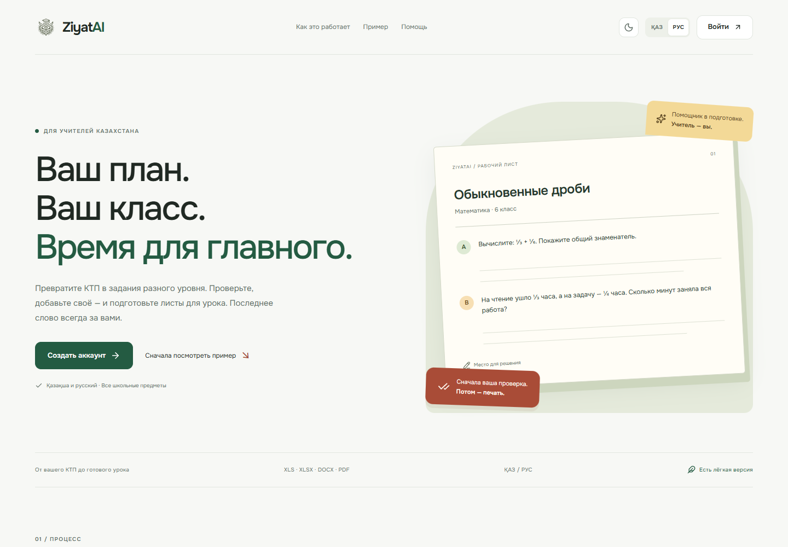

# ZiyatAI

ZiyatAI помогает учителям Казахстана загрузить КТП, проверить строки, подтвердить тему и цели, создать задания по своему предмету, отредактировать версии и выпустить DOCX/PDF. Предмет выбирается при регистрации и меняется в профиле. Интерфейс — қазақша/русский; язык исходника и заданий выбирается отдельно. Данные сохраняются в PostgreSQL, файлы — в приватном S3, длительные операции — в отдельном worker.

Для гостей `/` — знакомство с проектом и интерактивный пример; `/login` — вход, `/signup` — регистрация. Есть светлая/тёмная тема. В КТП можно пропустить все даты одной кнопкой и вернуть их до сохранения. Перед выпуском файлов учитель одобряет сохранённую версию заданий; сервер запрещает экспорт без одобрения, а после правки или перегенерации новая версия требует повторной проверки.

Основная схема размещения: **Netlify + Railway**. Пошаговая настройка сервисов, приватного storage, SMTP, шрифтов и ограничения тарифов: [docs/railway.md](docs/railway.md).

**Текущий статус: проверено локально, публичный production запуск не выполнен.** Настоящий OpenAI проверен на GPT-5.4 mini: генерация, замена одного задания и DOCX/PDF через работающую очередь. [Отчёт сценария](docs/reports/live-workflow.json) и [проверка трёх предметных/языковых сценариев](docs/reports/live-subjects.json). Педагогическая экспертиза ещё нужна. Синтетическое демо явно помечено и не выдаётся за AI. Полный перечень результатов и блокеров — в [приёмке](docs/acceptance.md).

Подтверждение почты — шестизначный код на 10 минут; есть повторная отправка и ограничение попыток. Локальная почта доступна в [Mailpit](http://localhost:8025). Для отправки на настоящий email и включения AI выполните [короткую настройку сервисов](docs/connect-services.md).

Вечерняя переработка добавляет гостевую главную, две темы, массовый пропуск дат и обязательное одобрение точной версии заданий перед печатью. [Свежий отчёт и ограничения](docs/reports/evening-2026-10-16.json), [решение по проверке учителем](docs/adr/004_review_and_public_entry.md). Проверки интерфейса и структуры AI не заменяют педагогическую экспертизу или публичную production-приёмку.

Проверено: **74 unit, 38 parser, 37 Chromium, 10 WebKit** и настоящий Firefox ESR 115.40.0. Source CI проходит, пять целевых контейнеров не имеют найденных Trivy HIGH/CRITICAL в распознанных пакетах; ограничения и прежние MEDIUM renderer отражены в отчётах.



[Проверка заданий](docs/images/review.png) · [Кабинет](docs/images/workspace.png) · [Мобильный экран](docs/images/mobile.png) · [Логотип и дизайн](docs/design.md) · [Облегчённый режим для старых браузеров](docs/browser-support.md)

**Для показа на настроенном ПК:** дважды нажмите `Start demo.cmd`. Скрипт запустит сервисы и откроет http://localhost:3000. [Сценарий демонстрации и варианты бесплатного размещения](docs/demo.md).

## Локальный запуск с нуля

Требуются Git, Node.js 24.22.0 LTS, Python 3.12–3.14 и работающий Docker Desktop/Engine с Linux контейнерами. На серверной машине нужно примерно 8GiB свободной RAM и место для образов. Учитель открывает сайт в браузере: Docker и Python на школьном ПК не нужны. Для старых браузеров предусмотрен [облегчённый режим](http://localhost:3000/lite/), подробнее — [совместимость](docs/browser-support.md).

Windows шрифты используются только локально с установленной лицензией; на Linux задайте FONT_DIRECTORY с законно установленными TNR/Arial/Calibri. Эти офисные шрифты в репозиторий и образы не включаются. Шрифт интерфейса Onest включён отдельно под SIL OFL, с поддержкой казахских букв; Lite использует системный шрифт.

```powershell
npm ci
python -m pip install -r apps/worker/requirements.lock.txt -r tests/requirements.txt
npm run local:setup
docker build -f infra/Dockerfile.postgres -t ziyatai-postgres:local .
npm run infra:up
npx tsx scripts/enable-local-renderer.ts
npx tsx scripts/prepare-local-containers.ts
docker compose -f infra/compose.tools-local.yml --env-file .env.local up -d --build
npm run migrate
npm run fixtures
npx tsx --env-file=.env.local scripts/configure-storage.ts
```

`local:setup` генерирует случайные локальные credentials в игнорируемом `.env.local` и конфигурацию локального Garage. Повторный запуск сохраняет их. `.env.local` не пересоздавайте при существующем PostgreSQL volume: иначе пароль БД и storage ключи разойдутся. В Windows используйте редактор UTF-8 без BOM; PowerShell `Set-Content -Encoding utf8` старых версий добавляет BOM и может испортить имя первой переменной.

Для разработки откройте два терминала:

```powershell
npm run dev
npm run worker
```

Для устойчивого локального запуска соберите и запустите web/worker контейнеры:

```powershell
docker build --build-arg UPLOAD_ORIGIN=http://127.0.0.1:53900 --target web -f infra/Dockerfile -t ziyatai-web:local .
docker build --target worker -f infra/Dockerfile -t ziyatai-worker:local .
docker compose -f infra/compose.app-local.yml up -d
```

Перед этим остановите `npm run dev` и `npm run worker`, чтобы не занимать порт 3000 и не запускать лишний worker. Данные находятся в именованных volumes; `docker compose down` их сохраняет. Не используйте `down -v`, если данные нужны.

Сайт: [localhost:3000](http://localhost:3000). Локальная почта: [localhost:8025](http://localhost:8025). Зарегистрируйте собственный email и откройте письмо в Mailpit для подтверждения. Это локальная доставка в тестовый ящик, а не письмо во внешний интернет. Общего admin/demo пароля нет. После входа кнопка синтетического демо идемпотентно создаёт личный пример на выбранном языке.

## Настройка OpenAI и production

Добавьте OPENAI_API_KEY и проверенный OPENAI_MODEL в `.env.local` редактором либо в secret manager хостинга. Никогда не отправляйте секреты в чат, git или frontend. После изменения перезапустите web и worker; для контейнеров повторите `prepare-local-containers.ts` и `docker compose ... up -d --force-recreate`.

```powershell
npx tsx --env-file=.env.local scripts/live-ai-smoke.ts
```

Без ключа smoke завершается статусом BLOCKED и не делает запрос. Успешный smoke проверяет контракт одного ответа, но не заменяет педагогическую оценку, 36 подготовленных сценариев и production E2E.

Для frontend выбран **Netlify**: [схема, бесплатный тариф и настройка](docs/netlify.md). PostgreSQL, worker, OCR, антивирус и конвертация PDF работают на отдельном сервере; бесплатный frontend не означает бесплатную работу всего сервиса. Аккаунт хостинга ещё не подключён, публичного деплоя нет.

Production план и минимальные внешние действия владельца — в [deploy.md](docs/deploy.md). [.env.example](.env.example) содержит только placeholders и используемые настройки. APP_ENV=production включает fail-closed требования антивируса и isolated renderer, отключает synthetic demo provider и требует real AI на startup. Локально собранный production bundle с APP_ENV=local остаётся локальной проверкой, не production приёмкой.

## Проверки

```powershell
npm run lint
npm run typecheck
npm run check:source
npm run check:railway
npm test
npm run test:parser
npm run test:e2e
npm audit --audit-level=moderate
python scripts/scan-secrets.py
npx tsx --env-file=.env.local scripts/queue-check.ts
npx tsx --env-file=.env.local scripts/restore-check.ts
npx tsx --env-file=.env.local scripts/antivirus-check.ts
npx tsx --env-file=.env.local scripts/load-check.ts
python scripts/parser-report.py
python scripts/document-check.py
npx tsx --env-file=.env.local scripts/upload-cleanup-check.ts
npx tsx --env-file=.env.local scripts/auth-reset-check.ts
npx tsx scripts/netlify-gateway-check.ts
npx tsx scripts/proxy-check.ts
npx tsx scripts/browser-check.ts
npx tsx scripts/legacy-browser-check.ts
```

E2E требует запущенных web, worker, PostgreSQL, S3, renderer, ClamAV, Mailpit и локально установленного Chrome. Проверки используют только синтетические данные и случайные пароли. Для `proxy-check.ts` отдельно соберите `docker build -f infra/Dockerfile.proxy -t ziyatai-proxy:local .`; gateway check использует уже собранный `ziyatai-web:local`. `.local/qa`, traces и резервные тестовые архивы игнорируются git; не публикуйте их как общую библиотеку. На CI выполняются lint/typecheck/unit/parser/build/audit/secret scan и интеграционные сценарии без лицензированных шрифтов, со сканированием ClamAV. Полный экспорт с TNR и приёмка на публичном staging проверяются отдельно. Для native Firefox 115 проверки нужны официальные локальные Firefox/geckodriver binaries; инструкция — в документе о совместимости.

## Документация

- [Исследование КТП и границы корпуса](docs/ktp-research.md)
- [Архитектура и лицензии](docs/adr/001_architecture.md), [инфраструктура и расходы](docs/adr/002_hosting.md)
- [Контракты API](docs/api.md), [модель угроз](docs/threat-model.md)
- [Деплой](docs/deploy.md), [эксплуатация и восстановление](docs/runbook.md)
- [Netlify](docs/netlify.md), [дизайн и логотип](docs/design.md), [поддержка браузеров](docs/browser-support.md)
- [Лицензии сторонних компонентов](THIRD_PARTY_NOTICES.md), [проверка шести production образов](docs/container-security.md)
- [Прогресс](docs/progress.md), [приёмка и внешние блокеры](docs/acceptance.md)

## Передача исходников

Для передачи исходников можно создать архив только отслеживаемых Git файлов:

```powershell
New-Item -ItemType Directory -Force .local | Out-Null
git archive --format=zip --output=.local/ziyatai-source.zip HEAD
```

Архив содержит код, документацию и `.env.example`; credentials и провайдеры настраиваются отдельно в окружении получателя. Git не включает локальную `.env.local`, тестовые выгрузки и каталоги сборок.

## Troubleshooting

Если БД недоступна, проверьте Docker и `docker compose -f infra/compose.local.yml --env-file .env.local ps`. Миграции защищены advisory lock и checksum; уже применённые файлы не редактируют. Для изменения схемы добавляют новую миграцию.

Если OCR не работает, проверьте renderer `/health`, языки kaz/rus в образе и ограничения памяти. Неразмеченный или повёрнутый скан может потребовать ручного восстановления; пустой результат не подставляет выдуманные уроки.

Если PDF сообщает FONT_UNAVAILABLE, установите лицензированный выбранный шрифт на mounted directory. Замена шрифта не выполняется скрытно. Если файл не создаётся, смотрите безопасный код job и логи renderer без исходного текста.

Для email проверьте SMTP port/STARTTLS и callback APP_URL; production требует TLS. Для 429 worker использует ограниченный backoff. AI_UNCERTAIN означает неизвестный исход внешнего запроса и возможную оплату; автоматический повтор такого случая отключён.

Для зависшей операции проверьте worker readiness/heartbeat. Истёкший lease подхватывается janitor, а старый lease token не может опубликовать результат. Кнопка retry доступна для импорта/экспорта; новый AI запрос создают с осознанием расхода лимита.
